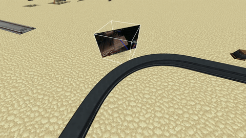
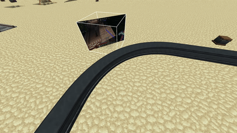

# Immersive Paintings: Enhanced

An addon for **Immersive Paintings** that keeps the original mod
untouched but fixes the places where it does not fit the rest of a heavily modded world.

Current enhancements:

| Enhancement | Default | Config key |
| --- | --- | --- |
| Hang pictures at **45 degrees** (sneak + right click a wall) | on | - |
| **Create contraptions / trains ignore pictures** instead of pushing, teleporting and killing them | on | `disableContraptionCollision`, `onlyTrains` |

## Usage

| Action | Result |
| --- | --- |
| Right click a wall | normal, axis aligned painting (unchanged) |
| **Sneak + right click a wall** | painting tilted 45 degrees |

While sneaking, the diagonal is chosen by *where on the block face you click*: the picture is
centred on the vertical block edge closest to your crosshair, and the canvas is tilted away from
the block so that it only touches that edge.

## Create compatibility

This mod makes immersive painting entities ignore collisions with create trains,
preventing weird entity displacement or bugs when trains trying to interact with painting entity.

### Before

### After

## Attribution

* Immersive Paintings - Copyright Luke100000 and contributors, GPL-3.0-only
  (<https://github.com/Luke100000/ImmersivePaintings>).
* This addon - Copyright its authors, GPL-3.0-only.
