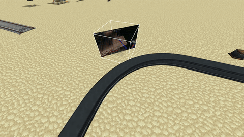
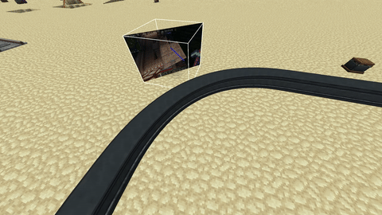

# Immersive Paintings：增强版

[English](README.md) | [简体中文](README_zh.md)

这是 **Immersive Paintings** 的一个附属模组，它不改动原模组本身，只修复原模组在重度模组化世界中
与其他内容不太契合的地方。

当前提供的增强：

| 增强内容 | 默认 | 配置项 |
| --- | --- | --- |
| 以 **45 度角**悬挂画作（潜行 + 右键点击墙面） | 开启 | - |
| **Create 的装置 / 列车忽略画作**，而不是推挤、传送并杀死它们 | 开启 | `disableContraptionCollision`、`onlyTrains` |

## 使用方法

| 操作 | 结果 |
| --- | --- |
| 右键点击墙面 | 正常、与坐标轴对齐的画作（行为不变） |
| **潜行 + 右键点击墙面** | 倾斜 45 度的画作 |

潜行时，对角线的方向由*你点击方块表面的位置*决定：画作以距离准星最近的竖直方块边缘为中心，
画布则向远离方块的方向倾斜，因此只与该边缘接触。

## Create 兼容性

本模组会让沉浸式画作实体忽略与 Create 列车的碰撞，避免列车尝试与画作实体交互时出现
奇怪的实体位移或 bug。

### 之前

### 之后

## 版权与署名

* Immersive Paintings - 版权归 Luke100000 及其贡献者所有，GPL-3.0-only
  (<https://github.com/Luke100000/ImmersivePaintings>)。
* 本附属模组 - 版权归其作者所有，GPL-3.0-only。
